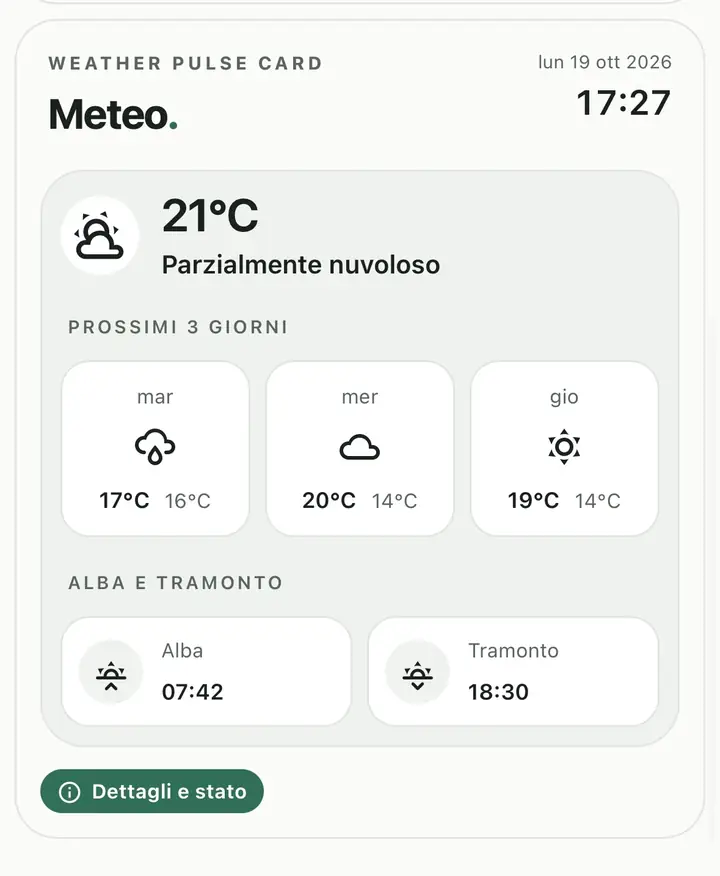

# Weather Pulse Card

**Weather Pulse Card** è una custom card per le dashboard di Home Assistant dedicata alle condizioni meteorologiche e alle previsioni, con un'interfaccia minimal ispirata al design Edera.

## Anteprima

## Funzionalità

- **Meteo attuale:** condizioni, temperatura, data e ora.
- **Previsioni dei prossimi 3 giorni:** condizioni meteorologiche e temperature minime e massime in riquadri compatti.
- **Alba e tramonto:** orari visibili direttamente nella card principale.
- **Dettagli e stato:** pannello con previsioni delle prossime 8 ore, andamento delle temperature, probabilità di precipitazione e informazioni aggiuntive.
- **Sole e luna:** percorso solare, durata del giorno e fase lunare, quando disponibili.
- **Condizioni atmosferiche:** umidità, vento, raffiche, pressione e altri dati supportati dalla sorgente configurata.
- **Allerte meteorologiche opzionali:** evidenza delle allerte disponibili e accesso alle relative informazioni.
- **Aspetto Edera:** temi Auto, Light e Dark, icone Material Design Icons di Home Assistant e impaginazione adattiva.
- **Configurazione visuale:** selezione delle entità e personalizzazione delle sezioni dall'editor di Home Assistant.

## Fonti dei dati

La card è progettata per utilizzare le entità meteorologiche già configurate in Home Assistant e le relative previsioni orarie e giornaliere, senza imporre un servizio meteo proprietario.

Gli orari di alba e tramonto si basano sull'integrazione **Sun** di Home Assistant. I dati lunari e le allerte sono opzionali e dipendono dalle sorgenti compatibili configurate.

La card non richiede abbonamenti o API a pagamento per le proprie funzionalità. Disponibilità dei dati, limiti d'uso ed eventuali condizioni del provider meteorologico dipendono dall'integrazione scelta.

I dati non disponibili non vengono presentati come misurazioni o previsioni certe.

## Allerte meteorologiche

Le allerte sono opzionali e dipendono dalle informazioni esposte da una sorgente compatibile configurata in Home Assistant. Livello di gravità, tipologia, validità e dettagli sono visualizzati soltanto quando disponibili.

Le informazioni mostrate dalla card non sostituiscono gli avvisi e le indicazioni delle autorità competenti. Per situazioni di rischio fare riferimento ai canali ufficiali di Protezione Civile e delle autorità locali.

## Privacy e sicurezza

Weather Pulse Card è progettata per funzionare nell'ambiente Home Assistant, senza richiedere un account dedicato alla card, credenziali di servizi esterni o accesso alla posizione GPS del dispositivo.

Il progetto non prevede pubblicità, tracciamento degli utenti o telemetria propria. Eventuali servizi esterni utilizzati dalle integrazioni meteorologiche di Home Assistant sono indipendenti dalla card e soggetti alle rispettive condizioni.

## Segnalazioni

Problemi e suggerimenti possono essere condivisi nella sezione [Issues](https://github.com/luigi-regolo/weather-pulse-card/issues). Prima di pubblicare configurazioni o log, rimuovere token, credenziali, indirizzi e altri dati personali.

## Licenza

Distribuito con licenza **GNU GPL-3.0-only**. Consultare il file [LICENSE](LICENSE).
